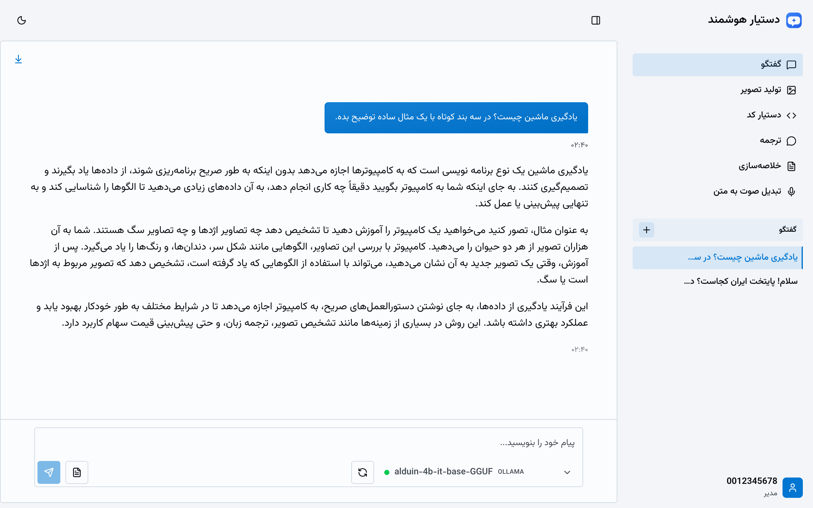
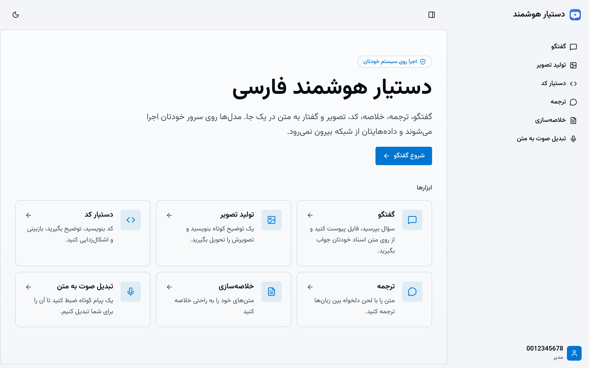
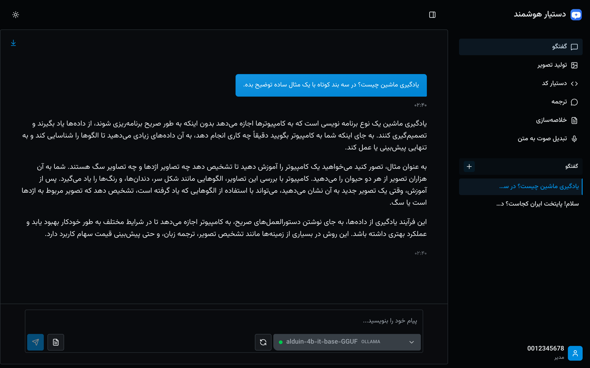
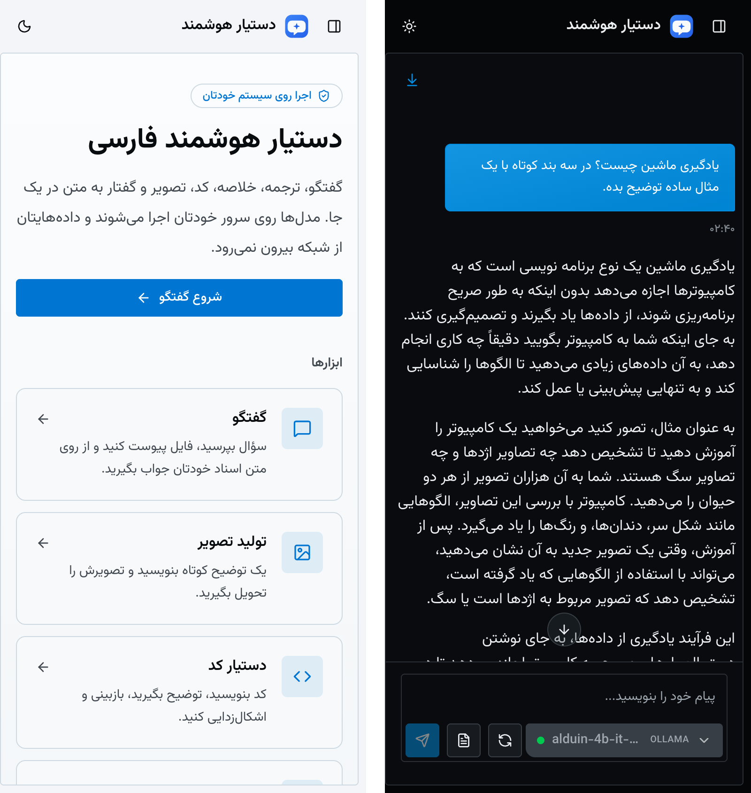
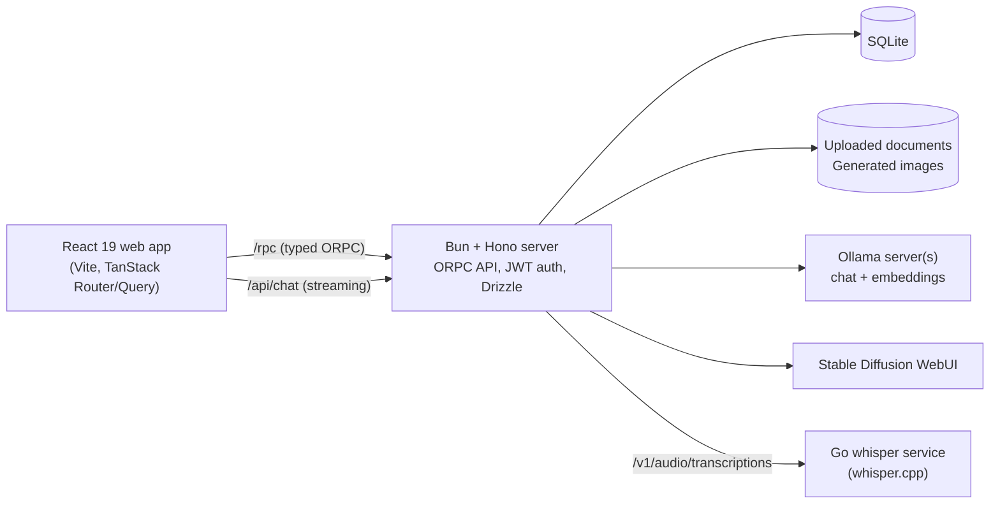

# Dastyar AI

A local-first, Persian-first AI assistant: chat, document Q&A, translation, summaries, code help, image generation, and speech-to-text. It runs on your own machine and talks to local model servers.



| Home | Chat, dark theme |
| --- | --- |
|  |  |

<p align="center"></p>

The interface is in Persian with a right-to-left layout. The screenshots use a 4B model on a local Ollama server.

## What it does

- **Chat.** Streaming chat with saved threads. The system prompt changes with the size of the selected model (small models get a shorter prompt). Answers default to Persian when the user's language is unclear.
- **Document Q&A (RAG).** Attach files to a thread. The server extracts text from PDF, DOCX, spreadsheets, HTML, EML, RTF, and plain text. It splits the text into chunks, embeds them with an Ollama embedding model, and retrieves the closest chunks by cosine similarity.
- **Translation.** Translate text between languages with a selectable tone. Results are saved as history.
- **Summaries.** Summarize text in several modes. Results are saved as history.
- **Code assistant.** Four modes: generate, explain, review, debug. Runs are saved.
- **Image generation.** Sends prompts to a Stable Diffusion WebUI (AUTOMATIC1111 API). Images are stored on disk and served by the API.
- **Speech to text.** Upload or record audio. A small Go service runs whisper.cpp and exposes an OpenAI-style transcription endpoint.
- **Multiple Ollama servers.** The admin can register several Ollama servers. The server sends each request to the least busy server that has the model.
- **Admin panel.** Manage users, models, Ollama servers, and per-feature toggles.
- **Persian text handling.** Text normalization for Persian input, RTL layout, and the Vazirmatn font.

LM Studio also works as a text provider through its OpenAI-compatible API (`http://localhost:1234/v1`). Add LM Studio models by hand in the admin panel. Automatic model discovery is off by default; the switch is `LMSTUDIO_ENABLED` in `apps/server/src/services/ai-providers/lmstudio-provider.ts`.

## Architecture



Why these choices:

- **Bun + Hono.** One runtime for the server, scripts, and tests. `bun build --compile` produces a single server binary.
- **ORPC.** The web app imports the server's router types. API calls are type-checked end to end without code generation. Chat streaming uses a plain Hono route with the Vercel AI SDK.
- **SQLite + Drizzle.** No database to install. Migrations run when the server starts.
- **Local model servers.** Prompts and documents stay on the user's machine or network.
- **Go for Whisper.** whisper.cpp has Go bindings. A separate process keeps the CGo build away from the Bun server.
- **One config file.** The server, the web dev proxy, the Go service, and the helper scripts all read `config.json` in the repo root.

## Tech stack

- Server: Bun, Hono, ORPC, Drizzle ORM, SQLite, Vercel AI SDK, Zod, bcryptjs, jsonwebtoken.
- Web: React 19, Vite 7, TanStack Router and Query, Tailwind CSS 4, Radix UI, jotai, react-hook-form.
- Transcription: Go, whisper.cpp, ffmpeg.
- Tooling: Turborepo, Bun workspaces, Biome with Ultracite, `bun test`, Testing Library.

## Quick start

Requirements: Bun 1.3 or newer. A running Ollama with at least one chat model. For document Q&A, also pull the embedding model (`ollama pull nomic-embed-text`). Whisper and Stable Diffusion are optional.

```bash
bun install
bun run config:generate   # writes config.json with a random JWT_SECRET
bun run config:validate
bun run dev:server        # API on http://localhost:3000
bun run dev:web           # web app on http://localhost:3001
```

Open `http://localhost:3001` and register. The username is a 10-digit number (the format of an Iranian national ID). The first account becomes the admin. Later accounts are regular users. To promote another account:

```bash
(cd apps/server && bun run make-admin <username>)
```

Optional: speech to text. This needs Go, CMake, and Git.

```bash
bun run build          # builds web, server, and the whisper service into dist/
bun run start          # starts the whisper service and the server from dist/
```

For development, build whisper.cpp once and then run the service on its own:

```bash
bun scripts/build.ts --skip-web --skip-server --skip-package
bun run dev:whisper
```

The build downloads `ggml-base.bin` and FFmpeg into `apps/whisper/`. For another model, run `bun run download:model ggml-small.bin`.

Other commands:

```bash
bun run status         # check service status
bun run stop           # stop services
bun run db:studio      # browse the database
```


## Configuration

Configuration lives in `config.json` in the repo root. It is not committed. `config.example.json` shows every key. `bun run config:validate` fails on missing or unknown keys.

| Key | Default | Meaning |
| --- | --- | --- |
| `PORT` | `3000` | API port |
| `HOST` | `0.0.0.0` | API bind address. Use `127.0.0.1` for a single machine. |
| `CORS_ORIGIN` | `*` | Allowed origins, comma separated |
| `JWT_SECRET` | random | Signing key, at least 32 characters. `config:generate` creates one. |
| `JWT_EXPIRES_IN` | `86400` | Token lifetime in seconds |
| `DATABASE_FILE` | `./data.db` | SQLite file |
| `WEB_DEV_PORT` | `3001` | Vite dev server port |
| `WEB_DIST_DIR` | `./web` | Built web files served by the server |
| `OLLAMA_BASE_URL` | `http://localhost:11434` | Ollama address |
| `OLLAMA_ENABLED` | `true` | Turn the Ollama provider on or off |
| `EMBEDDING_MODEL` | `nomic-embed-text` | Embedding model for document Q&A |
| `STABLE_DIFFUSION_BASE_URL` | `http://localhost:7860` | Stable Diffusion WebUI address |
| `IMAGES_DIR` | `./generated-images` | Image storage |
| `DOCUMENTS_DIR` | `./uploaded-documents` | Uploaded document storage |
| `WHISPER_SERVER_URL` | `http://127.0.0.1:8080` | Whisper service address (the port is also used by the service) |
| `WHISPER_MODEL_DIR` | `./models` | Whisper model folder |
| `WHISPER_MODELS` | `ggml-base.bin` | Whisper model file name |
| `WHISPER_TIMEOUT_MS` | `120000` | Transcription timeout |
| `SSL_ENABLED`, `SSL_CERT_PATH`, `SSL_KEY_PATH` | `false`, empty, empty | Optional TLS |

There is no `.env` file. Defaults are defined in `apps/server/src/config-schema.ts`.

### Security notes

- The server binds to `0.0.0.0` by default so other machines on the local network can use it. Put it behind TLS (`SSL_ENABLED`) or a reverse proxy before you expose it beyond a trusted network.
- The API authenticates with a bearer token, not cookies. A wildcard `CORS_ORIGIN` therefore does not let other sites act as a signed-in user. Set a list of origins to restrict browser access further.
- A release build ships with a placeholder `JWT_SECRET`. On first start, the server writes a random secret into `config.json`. If it cannot write the file, it stops.

## Documentation

This README is the English entry point. Detailed user guides (setup, server, web app, Whisper, commands, Windows setup, troubleshooting) are in Persian under [`docs/fa/`](docs/fa/index.html).

## Tests

```bash
bun run test          # server and web, through Turbo
bun run check-types
bun run lint:check
```

- Server (`bun test`): auth service and repository, file validation, upload indexing, PDF/DOCX/text extractors, Ollama routing score, Persian normalization, prompts, LLM JSON parsing, app config, startup secret handling.
- Web (`bun test` with happy-dom): UI components, error boundary, hooks, utilities.
- The Go whisper service has no tests yet.

GitHub Actions (`.github/workflows/ci.yml`) runs lint, type checks, tests, and the web build on every push and pull request to `main`.

## Project structure

```
apps/
  server/    Bun + Hono API
    src/procedures/   ORPC endpoints (auth, threads, documents, images, ...)
    src/routes/       Streaming chat and image file routes
    src/services/     AI providers, document processors, storage
    src/repositories/ Database access
    src/database/     Drizzle schema and SQL migrations
  web/       React app (routes, components, hooks)
  whisper/   Go HTTP service around whisper.cpp
scripts/     Build, package, start, stop, and status scripts
docs/fa/     User guides in Persian (HTML)
```

## License

MIT. See [LICENSE](LICENSE).
