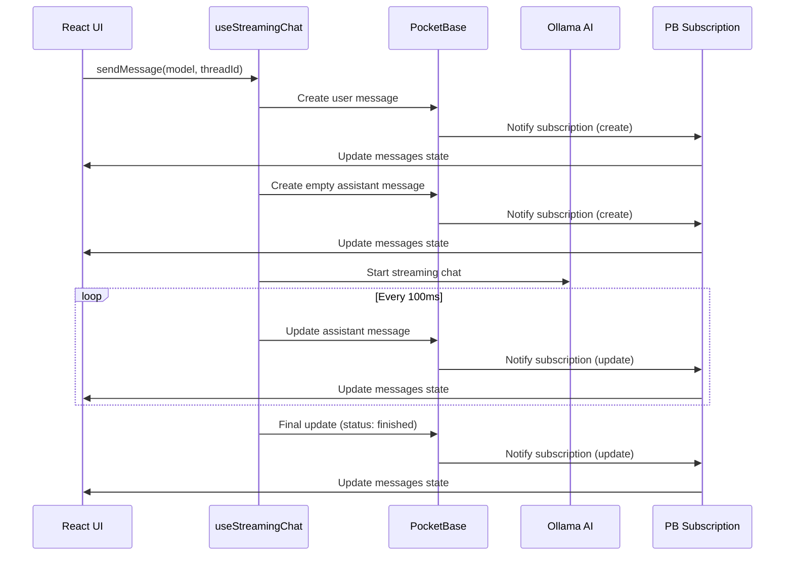

# Persian AI Assistant - Real-time Chat Architecture

## Overview

The Persian AI Assistant now uses **PocketBase real-time subscriptions** for a fully reactive chat experience. This architecture eliminates manual state management and provides real-time updates across browser sessions.

## Architecture Flow

### 1. **Message Creation & Streaming**



### 2. **Key Components**

#### **useStreamingChat Hook**

- **Subscribes** to PocketBase messages collection
- **Filters** by thread ID to only receive relevant updates
- **Handles** real-time create/update/delete events
- **Manages** Ollama streaming and periodic database updates

#### **PocketBase Subscription**

```typescript
pb.collection("messages").subscribe(
  "*",
  (event) => {
    const record = event.record as MessagesRecord;

    if (record.thread !== threadId) return;

    if (event.action === "create") {
      // Add new message to state
    } else if (event.action === "update") {
      // Update existing message in state
    } else if (event.action === "delete") {
      // Remove message from state
    }
  },
  {
    filter: `thread = "${threadId}"`,
  },
);
```

#### **Streaming State Management**

```typescript
// Initialize streaming state
let streamingState: StreamingState = {
  isReasoning: false,
  reasoningContent: "",
  responseContent: "",
  fullContent: "",
};

// Progressive reasoning parsing during streaming
const parseReasoningTokens = (content: string) => {
  const thinkStartIndex = content.indexOf("<think>");

  if (thinkStartIndex !== -1) {
    const thinkEndIndex = content.indexOf("</think>", thinkStartIndex);

    if (thinkEndIndex !== -1) {
      // Complete reasoning block - parse both reasoning and response
      const reasoning = content.substring(thinkStartIndex + 7, thinkEndIndex);
      const response = content.substring(thinkEndIndex + 8);
      return { reasoning, response };
    } else {
      // Incomplete reasoning block - still streaming reasoning
      const reasoning = content.substring(thinkStartIndex + 7);
      return { reasoning, response: "" };
    }
  }

  // No reasoning tags - treat as response content
  return { reasoning: "", response: content };
};

// Update every 100ms during streaming
setInterval(async () => {
  await pb.collection("messages").update(assistantMessageId, {
    content: streamingState.responseContent,
    reasoning: streamingState.reasoningContent,
    status: currentStatus,
  });
}, 100);
```

## Benefits

### 🚀 **Real-time Synchronization**

- Messages persist across page refreshes during streaming
- Multiple browser tabs stay synchronized
- No manual state management required

### 🎯 **Simplified Architecture**

- Eliminates temporary message state
- Reduces complex state synchronization logic
- Single source of truth (PocketBase database)

### 🔄 **Automatic Updates**

- UI updates automatically via subscriptions
- No need for manual refetching
- Consistent data across all components

### 🛡️ **Error Recovery**

- Data survives network interruptions
- Progressive saving prevents data loss
- Better debugging capabilities

## Technical Implementation

### **Database Schema**

```typescript
type MessagesRecord = {
  id: string;
  content: string;
  reasoning?: string;
  role: "user" | "assistant";
  status: "idle" | "reasoning" | "streaming" | "finished" | "errored";
  thread: string;
  model: string;
  created: string;
  updated: string;
  sent_at?: string;
};
```

### **Status Flow**

1. **idle** → Message created
2. **reasoning** → AI is thinking (for reasoning models)
3. **streaming** → AI is generating response
4. **finished** → Generation completed successfully
5. **errored** → Generation failed

### **Reasoning Model Support**

- **Progressive parsing**: Starts displaying reasoning as soon as `<think>` tag appears
- **Real-time updates**: Reasoning content updates live during streaming
- **Seamless transition**: Automatically switches to response content after `</think>`
- **Separate storage**: Reasoning and response stored independently in database
- **Dynamic status**: Real-time status updates (reasoning → streaming → finished)

## Usage Example

```typescript
// In React component
const { messages, sendMessage, isStreaming } = useStreamingChat(threadId);

// Send a message - everything else is automatic
await sendMessage("llama3.2", threadId);

// Messages state updates automatically via PocketBase subscriptions
// No manual state management needed
```

## Migration Benefits

### **Before** (Manual State Management)

- Complex temporary message handling
- Manual UI updates after each chunk
- State synchronization issues
- Data loss on page refresh during streaming

### **After** (PocketBase Subscriptions)

- Automatic real-time updates
- Persistent data during streaming
- Simplified component logic
- Zero manual state synchronization

## Development Notes

- **Subscription cleanup**: Automatically handled in useEffect cleanup
- **Memory management**: Intervals are properly cleared
- **Error handling**: Database errors don't crash the UI
- **Performance**: Only relevant messages trigger updates via filtering

This architecture provides a robust, scalable foundation for real-time chat functionality while maintaining simplicity and developer experience.
